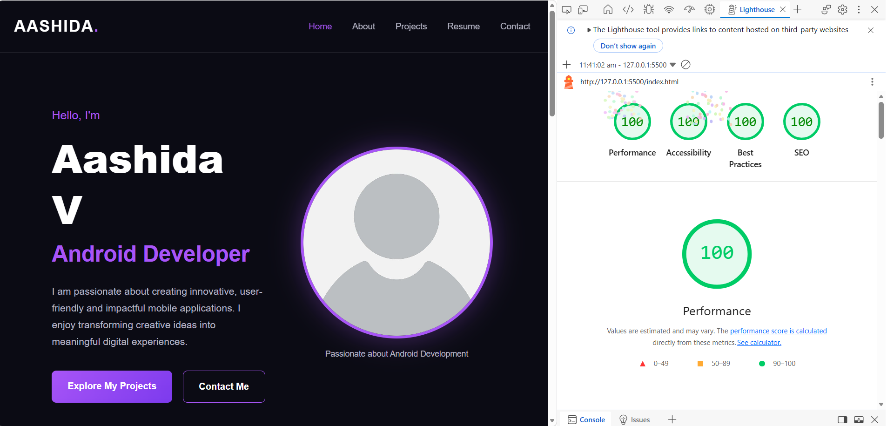

# Personal Portfolio Website

A responsive personal portfolio website created as part of the Thiranex Web Development Internship.

## About the Project

This portfolio showcases my profile as an aspiring Android Developer, including my introduction, technical skills, projects, education, and contact information.

## Pages

* Home – Introduction and skills overview
* About – Personal background and education
* Projects – Project showcase
* Resume – Education, skills, and experience
* Contact – Contact form and contact information

## Technologies Used

* HTML5
* CSS3
* JavaScript

## Features

* Semantic HTML5 structure
* Responsive design
* Dark theme with purple accents
* Accessible navigation
* Keyboard-friendly form fields
* Contact form validation
* SEO meta descriptions and page titles

## How to Run

1. Download or clone this repository.
2. Open the project folder in Visual Studio Code.
3. Open `index.html` using Live Server.
4. Navigate through the portfolio pages.

## Author

Aashida V

Android Developer | Web Development Intern

## Acknowledgement

Created as part of the Thiranex Web Development Internship.

## Lighthouse Audit Results

The portfolio website was tested using Google Lighthouse.

| Category | Score |
|---|---:|
| Performance | 100 |
| Accessibility | 100 |
| Best Practices | 100 |
| SEO | 100 |

### Audit Screenshot

